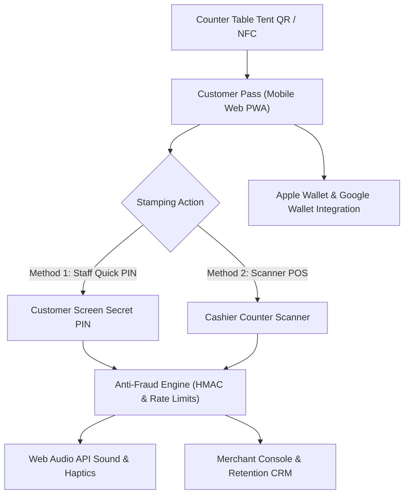

# Stampee — Digital Loyalty Stamp & POS Engine

> **Proprietary Commercial Architecture & Case Study**  
> Built by **Seif Walid** • Zero-app-download digital stamp cards and high-speed POS terminal for local businesses (cafés, restaurants, salons, retail).

---

## 🎯 The Core Problem & Solution

Traditional loyalty punch cards get lost, forged, or left behind. Existing loyalty apps (like Stamp Me or Monaasba) force customers to download native apps from the App Store at the checkout counter, causing line delays and high SaaS fees for small businesses.

**Stampee solves this with a 3-second counter checkout flow:**
1. **Client Pass (Mobile Web PWA / Apple Wallet)**: Customer scans the table tent QR code and instantly sees their tactile stamp pass in the browser. No app download or password creation required.
2. **Physical Rubber-Stamp Physics**: Synthetic mechanical stamp thud and paper friction rendered entirely via **Web Audio API** with native mobile haptics (`navigator.vibrate`) and random angle ink displacement.
3. **Cashier POS Terminal**: Counter staff scan or enter a 4-digit PIN to issue `+1` or `+2` stamps in under 3 seconds.
4. **Anti-Fraud Security**: Dynamic expiring HMAC tokens prevent QR code screenshots and unauthorized self-stamping.
5. **Smart Perks**: Welcome Stamp bonus upon joining, and automated Birthday Perks.

---

## 🏗️ System Architecture

---

## 🛡️ Anti-Theft & IP Protection

This repository is protected by a **Proprietary All Rights Reserved Commercial License**.
- Commercial reproduction, unauthorized hosting, and competing SaaS operations are legally prohibited.
- For commercial licensing or white-label inquiries, contact Seif Walid.

---

## 💻 Tech Stack
- **Frontend Framework**: React 18, TypeScript, Vite
- **Design System**: Tailwind CSS (Linear Dark Mode + Notion Tactile Craft Paper tokens)
- **Audio & Sensory Physics**: Native Web Audio API Sound Synthesizer (0 external mp3 dependencies)
- **Visuals & QR**: Canvas Confetti, QRCodeSVG, Lucide React
- **Wallet Standards**: Apple Wallet PassKit specification & Google Wallet API compatible schema

---

## 📄 License
Copyright (c) 2026 Seif Walid. All Rights Reserved. See [`LICENSE`](./LICENSE) for full legal terms.
